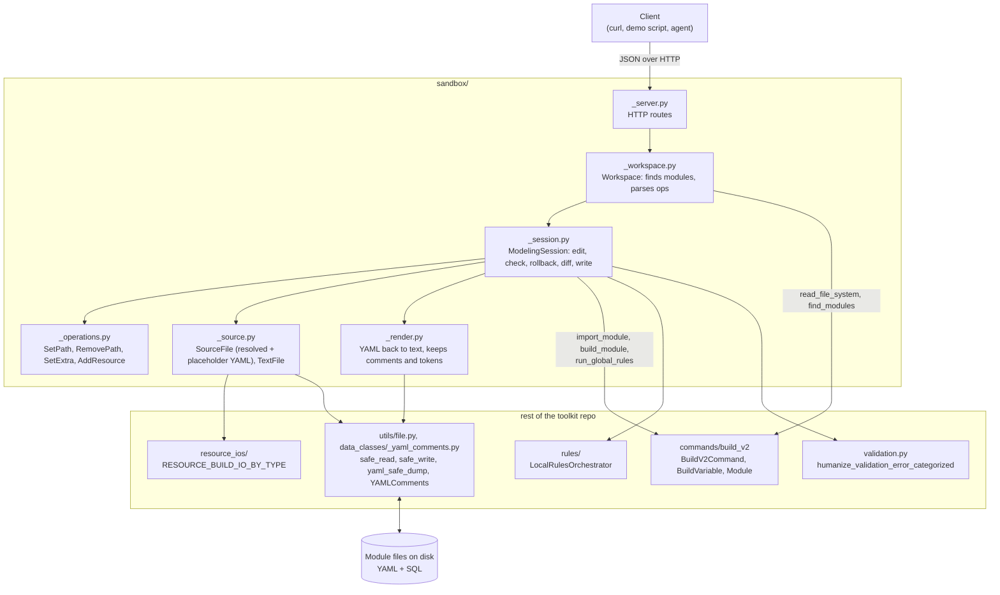

# Sandbox

A local, validated editor for Toolkit modules. It loads modules with the same code as `cdf build`, applies edits,
re-checks them with the build's rules, and writes only the edited files back. It never talks to CDF.

## Architecture



## How a request goes through the toolkit

**`POST /load`**

1. `Workspace.load` calls `BuildV2Command.read_file_system` and `BuildV2Command.find_modules`,
   the first steps of `cdf build`.
2. `ModelingSession.add_module` calls `BuildV2Command.import_module` to read the module's files.
3. Each YAML file becomes a `SourceFile`, validated with the resource class from `RESOURCE_BUILD_IO_BY_TYPE`.
   Variables are resolved with `BuildVariable`, and a copy keeps the original `{{ variable }}` tokens.
4. `_check()` runs `BuildV2Command.build_module`, `run_global_rules` and `filter_to_reported_insights`.

**`POST /apply`**

1. `Workspace.apply` turns the JSON into an operation. Operations are `SetPath`, `RemovePath`, `SetExtra` and `AddResource`.
2. The operation edits both the resolved and the placeholder form of the resource.
3. `_refresh` validates the edited resource again with the resource class (`validate_object`),
   so the errors are the same as in a build.
4. `_check()` runs the build and the rules again.
   If a new blocking insight appears, the edit is rolled back and `ok: false` is returned.

**`GET /diff`, `POST /write`**

1. `render_source_file` dumps the placeholder form and puts back the original comments (`YAMLComments`)
   and `{{ variable }}` tokens.
2. If the edit only adds properties, the new lines are spliced into the original text so the rest of the file is untouched.
3. `write()` saves with `safe_write`. Edited SQL files are written as they are.

## Run

```bash
uv run python -m cognite_toolkit._cdf_tk.sandbox --port 8765
```

The server turns on every alpha flag, so `cdf.toml` in the working directory does not matter.

`GET /` lists the routes and the operation schemas. See `demos/sandbox/run_demo.py` for an example session.
